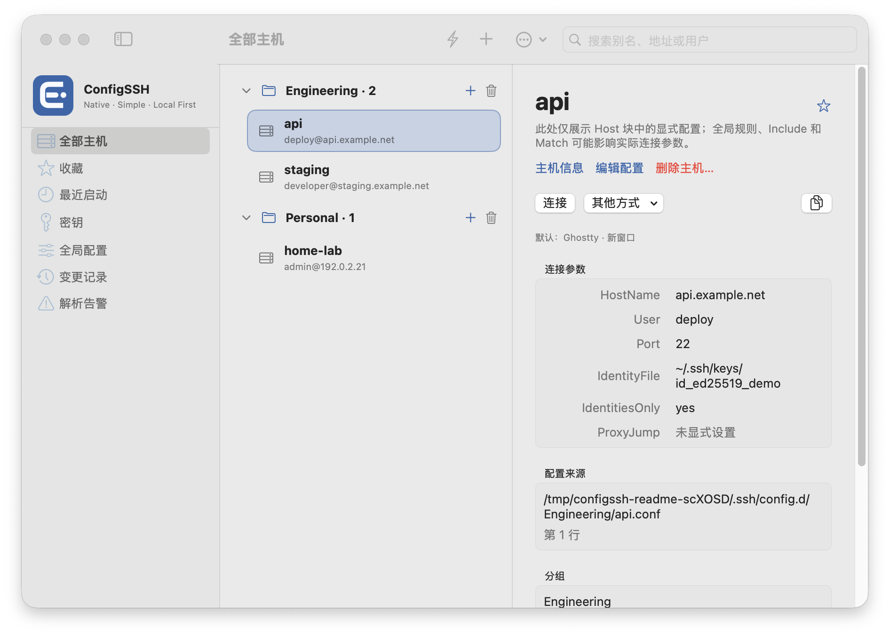
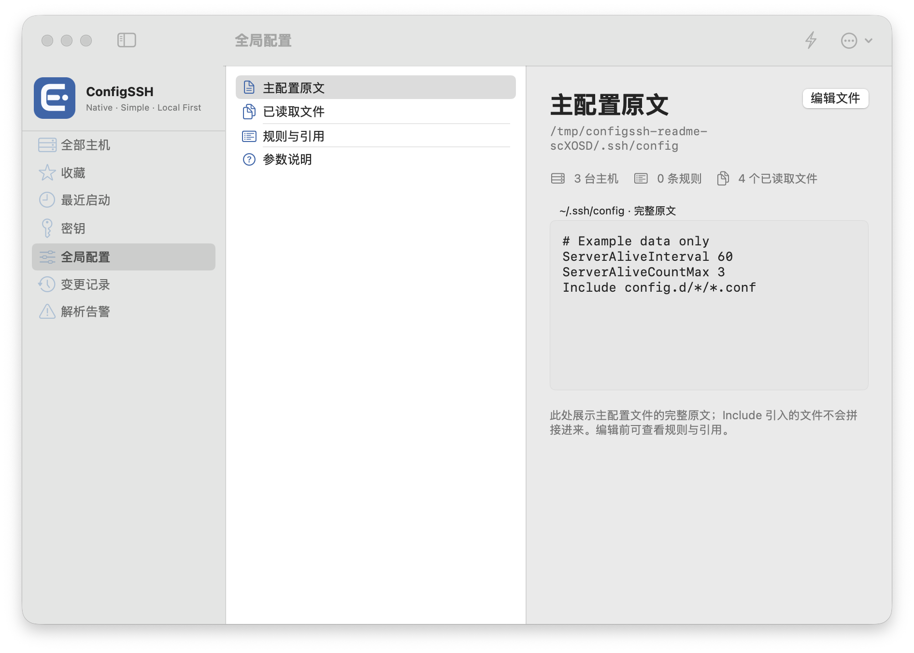
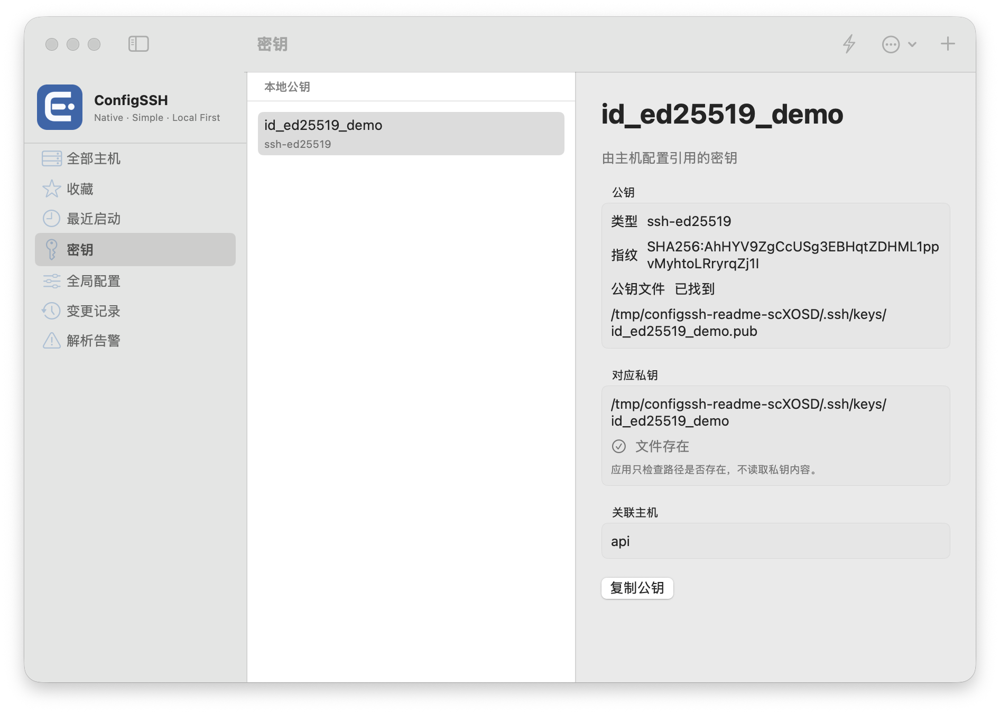
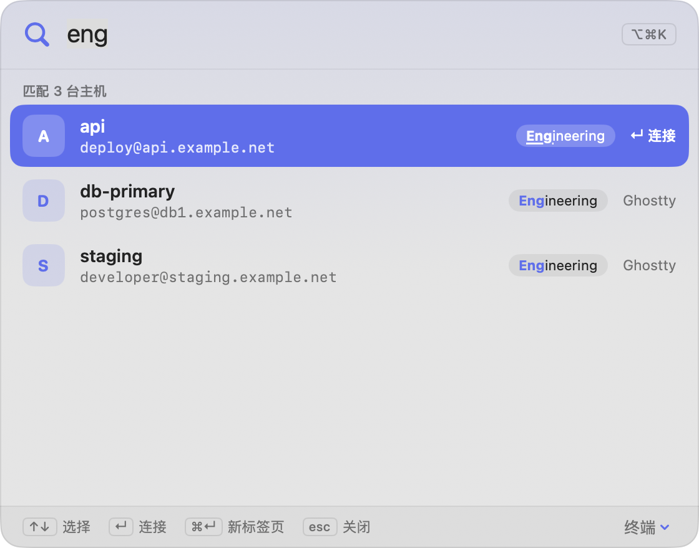
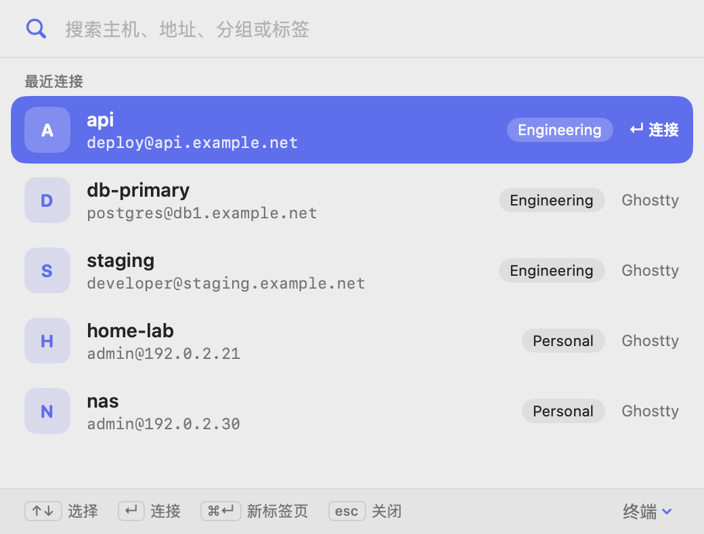

<div align="center">

# ConfigSSH

**在 macOS 上可视化管理 SSH 配置，选中主机后一键交给你常用的终端。**

Manage SSH Config Visually. Connect Effortlessly.

原生 macOS 应用 · 直接读写你的 `~/.ssh/config` · 本地优先 · MIT 开源

</div>



> [!NOTE]
> ConfigSSH 目前是**预览版**：只能从源码构建，或使用未签名的预发布包。详见[已知限制](#已知限制)。

## 目录

- [为什么用 ConfigSSH](#为什么用-configssh)
- [功能一览](#功能一览)
- [安装](#安装)
- [快速上手](#快速上手)
- [键盘快捷键](#键盘快捷键)
- [配置文件如何保存](#配置文件如何保存)
- [安全与隐私](#安全与隐私)
- [iCloud 加密同步](#icloud-加密同步)
- [常见问题](#常见问题)
- [已知限制](#已知限制)
- [参与开发](#参与开发)
- [许可证](#许可证)

## 为什么用 ConfigSSH

很多 SSH 客户端会把主机导入到自己的数据库，之后就要在两套配置之间来回同步。ConfigSSH 不这样做：

- **配置还是你的。** 所有连接信息仍保存在 `~/.ssh/config` 和它 `Include` 的文件里。不用 ConfigSSH 时，`ssh`、`scp`、VS Code Remote 等工具照常工作。
- **改动看得见。** 每次保存前都会展示逐行差异，写入前自动备份，随时可以恢复。
- **不碰你的认证。** 应用不保存 SSH 密码，日常使用也不会读取私钥内容；连接仍由系统 OpenSSH 在你的终端中完成。

## 功能一览

| 功能 | 你可以做什么 |
|---|---|
| 🗂 **主机管理** | 按分组浏览，支持搜索、收藏和折叠；可以创建空分组，或在分组旁直接新增主机 |
| ✏️ **安全编辑** | 用表单编辑 HostName、User、Port、IdentityFile、IdentitiesOnly、ProxyJump、连接复用等常用字段，或直接编辑 `config` 原文；详情页显示每台主机的配置原文；保存前预览差异，写入前备份 |
| ⚡️ **快速连接** | 双击主机即可连接；在任何应用中按全局快捷键 `⌥⌘K`，或点击菜单栏图标，即可搜索主机并直接打开终端连接；主窗口内按 `⌘K` |
| 🖥 **终端选择** | 自动识别 Terminal、Ghostty、Otty，其他终端可手动配置；支持按主机选择新窗口或新标签页 |
| 🔑 **密钥管理** | 索引公钥并显示被哪些主机引用；生成新的 Ed25519/RSA 密钥；用“部署公钥”向导输入一次密码即可把公钥装到服务器，改用密钥登录 |
| 🛟 **快照与恢复** | 每次修改自动备份；默认每天自动创建只含配置的本机快照（可改为每周或关闭），也可手动创建，预览差异后恢复 |
| ☁️ **iCloud 加密同步** | 把配置加密后推送到 iCloud Drive，在另一台 Mac 上预览差异后拉取；不上传私钥 |

<table>
<tr>
<td width="50%"></td>
<td width="50%"></td>
</tr>
<tr>
<td align="center"><b>全局配置</b>：查看主 <code>config</code> 原文，逐个查看 Include 文件</td>
<td align="center"><b>密钥</b>：查看指纹、引用关系，以及私钥是否存在</td>
</tr>
</table>

<sub>以上截图都来自用临时脱敏配置运行的真实应用窗口。`api.example.net`、`192.0.2.21` 等是示例地址，不是真实服务器。</sub>

## 安装

**系统要求：** macOS 14 Sonoma 或更新版本，Apple Silicon（arm64）。连接时使用系统自带的 OpenSSH。

### 方式一：下载预发布包

如果 [Releases](https://github.com/AlexWuYh/ConfigSSH/releases) 页面已有版本，按以下步骤安装：

1. 下载 `ConfigSSH-vX.Y.Z-unsigned-macos-arm64.zip` 和 `SHA256SUMS.txt`，放在同一目录。
2. 在该目录中校验下载包：
   ```bash
   shasum -a 256 -c SHA256SUMS.txt
   ```
3. 解压后，把 `ConfigSSH.app` 拖入“应用程序”文件夹。
4. 第一次打开时，macOS 会提示无法验证开发者。打开“系统设置 › 隐私与安全性”，在页面下方点击“仍要打开”。

> [!WARNING]
> 预发布包**没有签名，也没有公证**，只适合个人预览，不应再分发给他人。

### 方式二：从源码构建

需要 Swift 6 工具链（已在 Xcode 27.1 上验证）。

```bash
git clone https://github.com/AlexWuYh/ConfigSSH.git
cd ConfigSSH
swift run ConfigSSH
```

如果想得到一个可以放进“应用程序”的 `.app`：

```bash
./scripts/package-macos.sh
open dist/ConfigSSH.app
```

脚本不会覆盖已有的 `dist/ConfigSSH.app`。重新打包前，请先移走旧的包。

## 快速上手

### 1. 打开应用，查看现有主机

ConfigSSH 启动后会读取 `~/.ssh/config` 及其能访问的 `Include` 文件，按来源目录自动分组。这一步**只读取，不写入**。

- 无法安全定位的复杂规则（例如 `Match`、通配符 `Host *`）仍可查看，但不能用表单修改。
- 解析时发现的问题会显示为告警，不会阻止你查看其他主机。

### 2. 新增一台主机

在“全部主机”点击 **+**（或按 `⌘N`）。每个字段都标明了“必填/选填”，下面有一句说明和灰色的填写示例，填错时会立刻用红字提示原因。

- **显示名称**（选填）：列表和搜索框里显示的名字，可以用中文；留空就用 Host Alias。配置文件也以它命名，例如显示名称“生产环境 API”会保存为 `config.d/Engineering/生产环境 API.conf`，表单里会实时显示“将保存为”的路径。
- **Host Alias**（必填）、**HostName**（必填）、分组、User、Port、IdentityFile、ProxyJump 等按需填写。

点击保存后：

1. 应用先展示将要写入的内容和对 `config` 的改动；
2. 你确认后，它才会写入文件并建立备份。

新主机保存为独立文件，例如 `~/.ssh/config.d/api.conf`；如果选择了分组，则保存到 `~/.ssh/config.d/Work/api.conf`。

> [!TIP]
> 如果 ssh-agent 里有很多密钥，连接时出现 “Too many authentication failures”，可以把 **IdentitiesOnly** 设为 `yes`，这样 SSH 只会使用这台主机指定的密钥。开启前需要先填写或选择 IdentityFile；没有密钥时，应用不允许开启，并会提示原因。

### 3. 连接主机

**双击**主机，应用会用默认终端打开 `ssh <别名>`。你也可以：

- 在主机详情点击“主机信息”，为这台主机指定终端，以及用新窗口还是新标签页打开。

不打开主窗口也能连接，见下一节“随时搜索并连接”。

> [!TIP]
> 应用只负责把连接请求交给终端；能否登录成功，请以终端中 OpenSSH 的输出为准。

### 4. 随时搜索并连接

不必切换到 ConfigSSH 主窗口，有三个入口都能搜索主机并直接打开终端：

| 入口 | 怎么用 |
|---|---|
| **全局快捷键** | 在任何应用中按 `⌥⌘K`，屏幕上方弹出搜索框；再按一次或按 `Esc` 关闭 |
| **菜单栏图标** | 点击顶部菜单栏的 ConfigSSH 图标，在下拉面板中搜索 |
| **主窗口** | 在 ConfigSSH 中按 `⌘K` |

<table>
<tr>
<td width="50%"></td>
<td width="50%"></td>
</tr>
<tr>
<td align="center"><b>全局快捷键</b>：按 <code>⌥⌘K</code>，输入关键词筛选主机</td>
<td align="center"><b>菜单栏图标</b>：点击后在下拉面板中搜索</td>
</tr>
</table>

<sub>两张截图都来自用临时脱敏配置运行的真实应用。截图时为了能截取窗口，搜索面板用普通窗口承载，内容与实际弹出的面板相同；实际使用时搜索框浮在当前应用之上，菜单栏面板从顶部图标下方展开。</sub>

在搜索框中：

1. 输入别名、地址、用户名、显示名称、分组或标签的任意部分，多个关键词用空格分隔；
2. 用 `↑` / `↓` 选择主机，未输入时按最近连接排序；
3. 按 `↩`（或点击）连接。搜索框底部会一直写明 `↵` 将用哪个终端和打开方式（例如“Ghostty · 新窗口”），并标出它是默认终端还是这台主机单独设置的；点它可以换一个终端或改用新标签页，`⌘↵` 直接用新标签页。

全局快捷键默认是 `⌥⌘K`，可以自己定：打开“设置 › 通用 › 快速连接”，点“更改…”后直接按下想用的组合键即可录入（按 `Esc` 取消），也可以从“常用组合”里挑，或关闭、恢复默认。

- 组合键至少要包含 `⌘`、`⌃`、`⌥` 之一；只用 `⌥` 加字母会让这个字母在所有应用里打不出来，所以会被拒绝（`⌥Space`、`⌥F1` 这类不输入字符的键可以用）。
- 与 macOS 自带快捷键冲突的组合（如 `⌘Space`、`⌘Tab`、`⌘Q`）会被拒绝并说明原因；与输入法切换等常见用法重叠的组合会给出提示；已被其他应用占用的组合不会生效，并提示换一个。
- 全局快捷键只在 ConfigSSH 运行时有效，建议同时开启“开机自启”。

> [!NOTE]
> 全局搜索框不会把 ConfigSSH 切换到前台：只有在你选定主机、终端打开之后，焦点才会离开当前应用。

### 5. 选择你的终端

打开“设置 › 终端”，在“已安装的终端”中查看和配置：

- **自动识别：** Terminal、Ghostty、Otty。
- **其他终端：** 点击“选择其他终端应用…”，填写 CLI 的绝对路径，每行一个参数，用 `{alias}` 或 `{ssh}` 表示连接目标。
- **改回自动识别：** 把自定义的两个字段都清空，再保存。

第一次用 Terminal 或 Ghostty 启动时，macOS 会请求“自动化”权限，请选择允许。

### 6. 修改全局配置

“全局配置”页展示主 `config` 原文：

- 常见全局参数（如 `ServerAliveInterval`）可以用表单修改；
- 也可以点击“编辑”修改全文。保存前会做一次静态检查，阻止新引入的缺参数、引号不完整等错误。

## 键盘快捷键

| 快捷键 | 作用 |
|---|---|
| `⌘N` | 新增主机 |
| `⌥⌘K` | 全局快捷键：在任何应用中呼出主机搜索框（默认开启，可在“设置 › 通用”中录入任意组合或关闭） |
| `⌘↵` | 在搜索框中用新标签页打开选中的主机 |
| `⌘K` | 在主窗口中打开快速连接面板 |
| `⌘R` | 重新载入配置 |
| `↑` / `↓`，`↩` | 在搜索框中选择主机并连接 |
| `Esc` | 关闭搜索框或当前弹窗 |
| 双击主机 | 用默认终端连接 |

## 配置文件如何保存

```text
~/.ssh/
├── config              ← 全局参数，以及必要的 Include 入口
└── config.d/
    ├── api.conf        ← 未分组的主机，每台一个文件
    └── Work/           ← 分组 = 子目录
        └── staging.conf
```

- **`config` 只做入口。** 第一次新增主机时，应用会在 `config` 的 `Host` 规则之前加入 `Include config.d/*.conf` 等两行，并在预览中展示这次改动。
- **已有配置不迁移。** `config` 里原有的 `Host` 块会照常读取和显示，应用不会把它们搬到别处。
- **空分组会保留。** 删除分组中最后一台主机后，分组目录仍然保留。
- **删除分组前会预览。** 组内主机会被移动到“未分组”。如果遇到同名文件或无法识别的内容，操作会停止，不会覆盖任何文件。

## 安全与隐私

### ConfigSSH 会做的

- ✅ 写入前展示逐行差异，并在 `~/Library/Application Support/ConfigSSH/Backups` 保存备份（默认保留最近 50 条，可在设置中调整）。
- ✅ 写入前再次核对文件版本。如果在你预览之后，或保存的瞬间，有其他程序改动了同一文件，应用会**保留对方的版本**并提示冲突，不会覆盖。
- ✅ 用原子方式替换文件，并拒绝写入符号链接，或位于 `~/.ssh` 之外的路径。
- ✅ 索引密钥时只读取 `.pub` 公钥文件。

### ConfigSSH 不会做的

- ❌ 不保存 SSH 密码，日常使用不会把私钥内容读进应用。
- ❌ 不会自动运行 `ssh -G`，因为配置中的 `Match exec` 可能执行本机命令。
- ❌ 不会用简化表单改写无法安全定位的复杂配置。
- ❌ 不会把私钥上传到 iCloud。

### 本机快照中的密钥

“设置 › 配置与备份”中的手动快照默认**只包含配置文件**。如果要在本机快照中包含私钥，必须单次确认并逐个勾选密钥，副本会逐字节校验。

> [!CAUTION]
> 本机快照**不额外加密**，能访问快照文件的人可能拿到私钥。建议先为私钥设置口令。

恢复快照前，你会先看到差异。恢复只写回配置文件，不会恢复密钥，也不会删除快照之后新增的文件。

## iCloud 加密同步

适用于在多台 Mac 之间共享同一份 SSH 配置。

**它是怎么工作的**

- 每台 Mac 在 iCloud Drive 中有一个独立的 `Devices/<设备ID>.cssh` 文件，彼此不会覆盖。
- 内容在本机用 **AES-GCM** 加密，密钥由你设定的共享口令派生。口令不会上传。
- 只同步 `config` 和 `config.d/` 下的 `.conf` 文件，**不包含私钥**。

**第一次使用**

1. 打开“设置 › 配置与备份”，选择一个 iCloud Drive 文件夹。
2. 点击“连接测试、推送与拉取…”，再点“连接测试”。
3. 输入至少 12 个字符的口令，所有 Mac 使用同一个口令。可以选择“保存口令到本机钥匙串”，以后打开时自动填入。

**推送（本机 → iCloud）**：点击“预览推送”，确认文件数量后，再输入一次口令。`~/.ssh` 之外或非受管的 Include 文件会被跳过并列出来，需要你确认云端副本可能不完整。

**拉取（iCloud → 本机）**：选择一台设备，点击“预览拉取”，逐个文件查看差异后再确认。拉取只覆盖**同路径**的文件，并会先备份；本机其他文件保持不变。

**更换了口令？** 用新口令推送时，如果这台 Mac 原来的云端文件无法解密，应用会停下，并提供“覆盖此设备的云端文件…”。这个操作：

- 需要单独勾选确认；
- 会先把旧文件原样（仍为加密状态）备份到本机 `Backups/CloudSlots/`；
- 只影响这台 Mac 自己的文件。

> [!IMPORTANT]
> 应用只能确认文件已写入本机的 iCloud Drive 目录，**无法确认已上传到云端**。请在 Finder 中查看同步状态。口令丢失后，云端配置无法解密。

## 常见问题

<details>
<summary><b>ConfigSSH 会修改我现有的 <code>~/.ssh/config</code> 吗？</b></summary>

只在你确认之后才会修改。打开应用只读取配置。所有写入都要先经过差异预览，并在写入前自动备份。第一次新增主机时，应用会在 `config` 中加入 `Include` 行，预览里会明确展示这一处改动。
</details>

<details>
<summary><b>为什么有些主机不能编辑？</b></summary>

当主机来自条件 Include，包含 `ProxyCommand`、嵌套 `Include`，或者无法精确定位它在文件中的位置时，应用会把它设为只读，避免误改相邻规则。这类主机可以在“全局配置”中用全文编辑修改，或使用你常用的编辑器。
</details>

<details>
<summary><b>点击连接后终端没有反应？</b></summary>

1. 打开“系统设置 › 隐私与安全性 › 自动化”，确认 ConfigSSH 可以控制对应终端；
2. 在“设置 › 终端”中查看该终端的检测状态；
3. 对于自定义终端，确认 CLI 使用绝对路径，并且参数中包含 `{alias}` 或 `{ssh}`。
</details>

<details>
<summary><b>改错了怎么恢复？</b></summary>

打开“设置 › 配置与备份”，找到对应的变更记录，选择恢复。恢复前同样会展示差异；如果该文件之后又被修改过，应用会提示你先比较。
</details>

<details>
<summary><b>在另一台 Mac 上拉取后，部分 Include 路径不对？</b></summary>

不同 Mac 的绝对路径、`IdentityFile` 位置可能不同，外部 Include 也不会被同步。拉取后请检查这些路径，需要时手动调整。
</details>

## 已知限制

- 预发布包未签名、未公证，Gatekeeper 会提示风险。
- 全文编辑的静态检查**不能保证**所有 OpenSSH 参数在当前系统上有效。
- 目前只提供 Apple Silicon（arm64）版本。

开发进度见 [MILESTONES.md](MILESTONES.md)。

## 参与开发

```bash
swift build          # 编译
swift test           # 运行测试（只使用临时目录，不会触碰你的真实 ~/.ssh）
swift build -c release
```

| 目录 | 内容 |
|---|---|
| `Sources/ConfigSSH/` | SwiftUI 界面与应用入口 |
| `Sources/ConfigSSHCore/` | 配置解析、写入、备份、同步等与界面无关的逻辑 |
| `Tests/ConfigSSHCoreTests/` | 基于临时目录的测试 |
| `scripts/` | 打包、公证、发布检查脚本 |

贡献前请先阅读 [AGENTS.md](AGENTS.md) 中的实现约束。发布流程和 Release Notes 规范见 [docs/RELEASING.md](docs/RELEASING.md)。

## 许可证

[MIT License](LICENSE)
